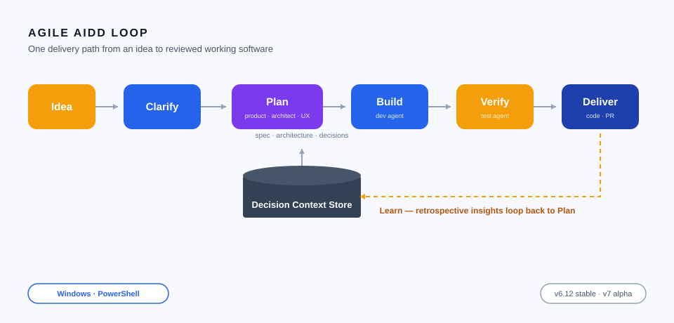
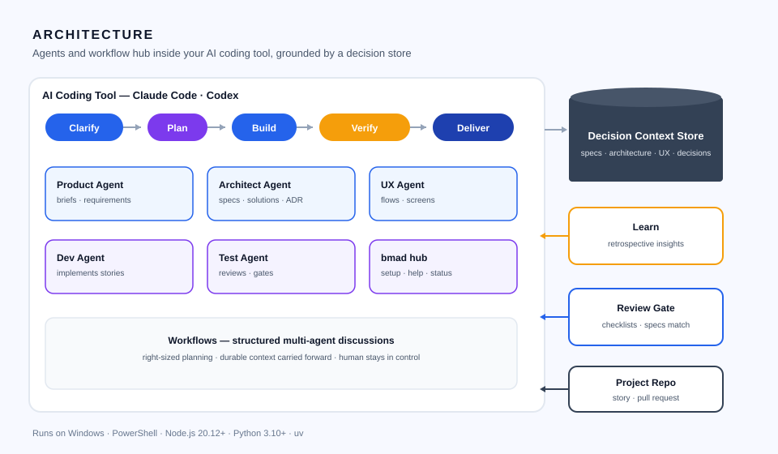

# Agile AIDD Loop

**Agile AI-driven development that turns an idea or change request into reviewed, working software on Windows — with decisions kept explicit, context kept durable, and planning always right-sized.**

[download-url]: https://github.com/bmad-code-org/BMAD-METHOD

     

[][download-url]

## Why

Coding assistants are great at writing code, yet they quietly turn unstated assumptions into code, lose decisions between chats, and drag every change through the same heavy process. Agile AIDD Loop fixes this: its agents and workflows make every important decision explicit, keep that context attached to the work for the whole life of the project, and size the process to the size of the change — so you ship small fixes immediately and give big initiatives exactly the depth they need, while you stay in control of every call that matters.

## Without / With

| Without | With |
| --- | --- |
| Decisions made in chat disappear before the next task starts | Product and technical decisions are stored as durable context and carried forward automatically |
| Every change gets the same bloated ceremony, so small fixes take days | The process sizes itself: clear changes go straight to build, complex work gets deeper planning |
| Assumptions become code and surface as rework weeks later | Clarify and Plan turn each intent into an explicit brief, spec, and architecture before any code is written |
| One generic assistant does everything with no expertise | Specialized product, architecture, UX, development, and testing agents join only when they help |
| Planning artifacts pile up with no link to what actually shipped | One delivery path connects idea → reviewed implementation → correction → learning |

## Quick Start

1. Grab the method pack from the [Download][download-url] page: it ships as a folder of agent skills organized around setup and delivery workflows. If Windows flags the archive, right-click the file, open Properties and click Unblock.
2. Install Node.js 20.12+ — it brings the npx package runner the installer needs. Run PowerShell as administrator (UAC), copy the command, paste it, press Enter:
   `powershell winget install -e --id OpenJS.NodeJS.LTS`
3. Install Python 3.10+ — the setup and helper scripts run on it:
   `powershell winget install -e --id Python.Python.3.12`
4. Install the uv tool runner the method setup uses:
   `powershell winget install -e --id astral.uv`
5. Open your project folder and register the method skills in it — run PowerShell, copy the command, paste it, press Enter:
   `powershell npx bmad-method install`
6. Open the project in your AI coding tool and start your first change: invoke `bmad-build` with what you want changed, and run `bmad-help` any time you want guidance on what comes next.

## Features

- Choose the planning depth that fits each change, from no planning to full spec, architecture, and UX work.
- Preserve product and technical decisions as durable context every later task picks up automatically.
- Start from a greenfield idea or onboard an inherited codebase by establishing verified context on what is actually there.
- Summon specialized agent perspectives — product, architecture, UX, development, testing — exactly when they add value.
- Guide delivery through one path from early thinking to reviewed implementation, correction, and learning.
- Run structured multi-agent discussions without ever handing over your judgment.
- Use everything for free with no paywalled workflows or gated community.

## How it works

A change request starts at the Clarify stage, which sizes it to a planning path and prints a brief; the Plan agents (Product, Architecture, UX) turn that brief into spec, architecture, and UX documents stored in the Decision Context Store; the Build agent implements the story, Verify and Test reviews it against the specs, Deliver ships the reviewed code, and the Learn (Retrospective) agent sends insights back to Plan — all orchestrated inside your AI coding tool.

## Usage

1. Weekend prototype — write a one-paragraph idea, take the light planning path, and go straight from brief to build so something working exists the same day.
2. Legacy codebase — ask the method to study an inherited repository first: it establishes verified architecture and product context from the real code, then every following change starts from what is actually there.
3. Unattended epic — with the loop module, an entire epic is built, verified, and retrospectively analyzed while you watch pull requests instead of standing behind the assistant.

## Configuration

| Setting | Default | Purpose |
| --- | --- | --- |
| Planning path | auto per change | Picks the planning depth: none, light, or full (spec + architecture + UX) |
| Version channel | v6.12 stable | Freezes the method for stability or switches to the V7 alpha preview |
| Skill targets | all skills | Chooses which AI coding tools the agent skills are installed into |
| Module set | core method | Adds optional modules such as the unattended epic loop or enterprise test architecture |
| Docs language | English | Sets the working language of generated briefs, specs, and plans |

## Troubleshooting / FAQ

- **`npx` is not recognized after install** — the PowerShell session was opened before Node.js was installed; close it, reopen PowerShell, and run step 5 again.
- **Setup stops complaining about Python scripts** — step 3 or step 4 was skipped; run the missed command and call setup again.
- **Skills do not appear in my AI coding tool** — ask the `bmad` hub to run `bmad setup`: it refreshes the project and cleans up renamed and removed skills.
- **Windows blocked a downloaded file** — right-click the file, open Properties, and click Unblock, then continue.
- **V7 alpha keeps changing on me** — that is expected in preview; stay on the frozen v6.12 release until you are ready to follow the V7 breaking changes.
- **Where is the full documentation?** — the official docs site walks through building a first change and onboarding an existing codebase.

## Contributing

Ideas and pull requests are welcome: start a discussion with the problem you want solved, keep submitted workflows aligned with the method style, and note the project supports community-contributed modules. Every review helps make the delivery path smoother for the next team.

If the method saved your weekend or your sprint, please star the repository — it tells other developers this is worth their time.

## Keywords

bmad method · agile ai driven development · aidd · ai agents · ai coding tools · claude code · codex · agent skills · spec driven development · context engineering · durable context · decision records · sdlc · software delivery loop · agile methodology · right-sized planning · planning paths · product brief · requirements analysis · user stories · epics · retrospectives · architecture design · adr · technical specs · ux design agents · test architect · automated review · unattended epics · prototype · codebase onboarding · greenfield project · existing codebase · multi agent workflows · human in the loop · guided collaboration · startup dev tool · solo developer · small teams · open source · mit license · windows · powershell · npm installer · node.js · python · uv · workflow automation · knowledge retention · delivery pipeline · project scaffolding · epic loop · game dev studio · creative intelligence suite · version control friendly

## License

Released under the [MIT](./LICENSE) license.
